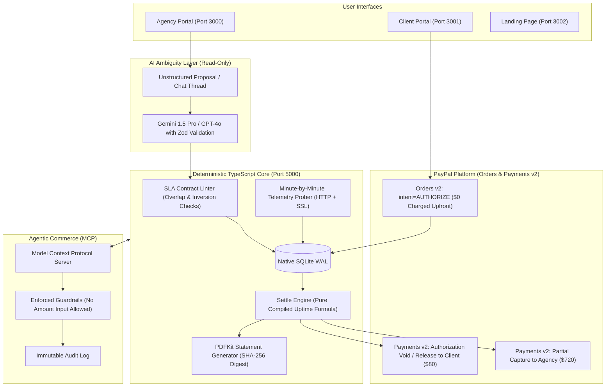

# Retainer Referee

Self-enforcing website retainer contracts backed by PayPal authorizations and deterministic SLA probing.

Clients and agencies negotiate maintenance retainers in unstructured proposals, chat threads, and emails. Retainer Referee converts those threads into machine-verifiable SLAs, holds the client's monthly retainer in a PayPal Sandbox authorization, monitors the production site with deterministic telemetry probes, and settles payment at period close by releasing SLA credits automatically.

AI reads the contract. Code decides the money.

---

## System Architecture



---

## Why this exists

Website retainer agreements and hosting SLAs run on manual honor systems:
- Contracts promise 99.9% uptime, but over 95% of SLA failure credits go unclaimed.
- Claiming a credit requires manual detection, log extraction, tickets, and disputes.
- Agencies have little incentive to calculate and issue downtime refunds proactively.
- Chargebacks and disputes lack cryptographic, third-party verifiable evidence.

Retainer Referee makes SLA contracts executable. Fees, uptime targets, tiered credit schedules, and scheduled maintenance windows are agreed upfront. The retainer fee is placed on hold with PayPal ($0 charged today), and settlement decisions are computed strictly by code audited line by line.

---

## How it works

1. **Extract and lint the contract.** An agency pastes an unstructured proposal or chat thread. AI parses terms into structured schemas. A deterministic linter audits the parameters, identifying tier boundary overlaps and blocking activation until resolved.
2. **Authorize the hold.** The backend issues a PayPal Orders v2 request with `intent: AUTHORIZE`. The client approves the hold; funds are authorized and held on their payment method ($0 charged upfront).
3. **Monitor endpoint health.** A background prober pings the site every minute, recording HTTP status codes, latencies, and SSL certificate health. Contractual maintenance windows (such as Sunday 02:00 to 04:00 UTC) are excluded automatically.
4. **Compute deterministic math.** At period end, compiled TypeScript code calculates uptime:
   $$\text{Uptime \%} = \left( \frac{\text{Eligible Minutes} - \text{Downtime Minutes}}{\text{Eligible Minutes}} \right) \times 100$$
   For example, 164 downtime minutes over 30 days (43,200 minutes) equals 99.62% uptime, activating Tier 1 (a 10% credit).
5. **Execute dual settlement.** PayPal Payments v2 captures $720.00 to the agency and releases the $80.00 credit back to the client immediately.
6. **Generate statement and audit ledger.** The system produces an itemized statement, SHA-256 integrity hash, and downloadable PDF with PayPal Order, Authorization, and Capture IDs.

---

## Judge quick start (3 steps)

Prerequisite: Node.js (v18 or higher) and npm.

### 1. Install and run

```bash
# Clone the repository
git clone https://github.com/AbhinavBangar1/Retrainer-Refree.git
cd Retrainer-Refree

# Install dependencies
npm install

# Start all 4 services concurrently
npm start
```

Applications boot across local ports:
- Landing Page: `http://localhost:3002`
- Agency Portal: `http://localhost:3000`
- Client Portal: `http://localhost:3001`
- Backend API: `http://localhost:5000`

### 2. Choose evaluation mode

- **Zero-config simulator (Default)**: Leave `.env` blank or absent. The engine runs offline using a built-in sandbox simulator that models PayPal Orders v2 and Payments v2 responses, paired with deterministic regex fallback extractors. No external API keys or PayPal logins required.
- **Live Sandbox & LLMs**: Copy the configuration file:
  ```bash
  cp .env.example .env
  ```
  Add your credentials:
  ```env
  PORT=5000
  PAYPAL_CLIENT_ID=your_paypal_sandbox_client_id
  PAYPAL_CLIENT_SECRET=your_paypal_sandbox_client_secret
  PAYPAL_BASE_URL=https://api-m.sandbox.paypal.com
  PAYPAL_SIMULATOR=false
  GEMINI_API_KEY=your_gemini_api_key
  OPENAI_API_KEY=your_openai_api_key
  PROBE_INTERVAL_MS=60000
  ```

### 3. Run the automated core loop test

Execute the complete end-to-end test suite covering all 6 stages of the lifecycle:

```bash
npm run test:loop
```

The test validates:
1. AI schema extraction and deterministic contract linting.
2. PayPal Orders v2 `intent: AUTHORIZE` creation and hold verification.
3. Live chaos injection (HTTP 503 outage trigger and resolution).
4. Deterministic SLA math and tier matching.
5. Dual programmatic execution: capturing agency fees and releasing client credits.
6. Cryptographic PDF statement generation and webhook logging.

---

## PayPal integration

Implemented using standard PayPal Orders v2 and Payments v2 protocols:

| Step | API Endpoint | Result |
| :--- | :--- | :--- |
| **Create order** | `POST /v2/checkout/orders` with `intent: "AUTHORIZE"` | Order ID and client approval URL |
| **Buyer approval** | PayPal sandbox modal checkout | Order status becomes `APPROVED` |
| **Place hold** | `POST /v2/checkout/orders/{id}/authorize` | Authorization ID; funds held on buyer source |
| **Settle / Capture** | `POST /v2/payments/authorizations/{id}/capture` | Capture ID; earned fee transferred with `final_capture: true` |
| **Release credit** | `POST /v2/payments/authorizations/{id}/void` | Uncaptured authorization balance released back to buyer |

### Security guardrails

- Environment sandboxing: Sandbox mode is strictly enforced; live production credentials cannot be executed.
- Server-side settlement calculation: The amount captured is strictly computed by server-side TypeScript code; client apps cannot supply payment amounts.
- Final capture enforcement: Capture calls explicitly pass `final_capture: true`, preventing lingering authorizations.
- Offline resilience: Realistic simulator mode generates valid `ORD-`, `AUTH-`, and `CAP-` tokens when offline evaluation is desired.

---

## AI contract extraction and guardrails

The service interfaces with Google Gemini or OpenAI chat completions endpoints:
- Structured schema extraction: Prompts require strict JSON matching the `ContractSlaSchema`.
- Server-side validation: Model responses are validated through Zod schemas before reaching the database.
- Separation of concerns: AI is restricted to language comprehension and textual summaries. Mathematical uptime calculations and dollar distributions are executed by compiled code.
- Deterministic fallback: When API keys are absent, a deterministic heuristic extractor parses currencies, percentages, and exclusions offline.

---

## Agentic commerce via MCP

Retainer Referee includes a Model Context Protocol (MCP) server allowing autonomous agents (such as Claude Desktop, Cursor, or Antigravity) to manage contracts:

### Available MCP tools

| Tool | Purpose |
| :--- | :--- |
| `create_contract_from_text` | Parses unstructured text into a draft contract schema |
| `check_contract` | Lints terms for logic errors and tier overlaps |
| `backtest_contract` | Simulates financial performance against historical CSV data |
| `list_contracts` | Lists managed contracts and operational statuses |
| `get_uptime_report` | Retrieves real-time probe logs and uptime metrics |
| `preview_settlement` | Previews earned fees and credits without updating state |
| `settle_period` | Triggers final settlement. Strictly requires `confirm: true` |
| `create_watch` | Starts non-enrolled monitoring in Customer Evidence Mode |
| `get_claim_pack` | Generates proof packs with SHA-256 integrity hashes |

### MCP guardrails

- No monetary parameters: No tool accepts a currency or dollar amount argument; all calculations derive from code and telemetry.
- Human confirmation: Settlement calls missing `confirm: true` are rejected.
- Audit ledger: Every agent invocation is stored in an immutable SQLite audit log accessible at `GET /api/mcp/audit`.

---

## Project directory layout

```text
.
├── src/
│   ├── index.ts                  # Server bootstrap and route mounting
│   ├── db/index.ts               # SQLite persistence layer (node:sqlite)
│   ├── mcp/server.ts             # Model Context Protocol stdio and SSE server
│   ├── routes/                   # Express routes (contracts, evidence, mcp, settle, webhooks)
│   ├── services/
│   │   ├── ai_explainer.ts       # AI narrative and plain-English summary generation
│   │   ├── contract_checker.ts   # Deterministic contract linter and back-test engine
│   │   ├── evidence_service.ts   # Customer Evidence Mode and claim pack compiler
│   │   ├── llm_extractor.ts      # LLM contract parser with Zod schema enforcement
│   │   ├── mcp_service.ts        # MCP business logic and guardrail layer
│   │   ├── paypal_client.ts      # PayPal Orders v2 & Payments v2 client and simulator
│   │   ├── pdf_generator.ts      # PDFKit cryptographic statement generator
│   │   ├── prober.ts             # Minute-by-minute endpoint health monitor
│   │   └── settle_engine.ts      # Deterministic mathematical settlement engine
│   └── types/index.ts            # TypeScript interfaces and schemas
├── agency/                       # Agency React portal (port 3000)
├── client/                       # Client React portal (port 3001)
├── landing/                      # Landing page application (port 3002)
├── tests/
│   └── verify_core_loop.ts       # Automated 6-stage end-to-end verification test
├── images/                       # High-resolution screenshots of all screens
├── LICENSE                       # MIT License
├── package.json
└── README.md
```

---

## License

This project is licensed under the MIT License. See the [LICENSE](LICENSE) file for details.
